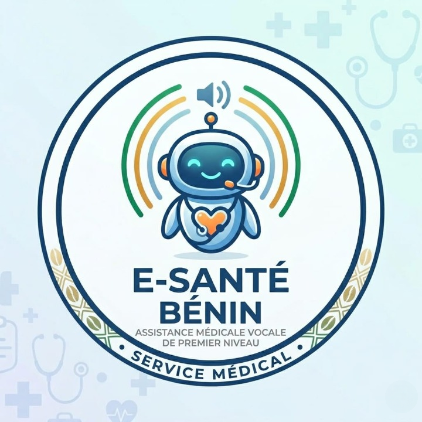
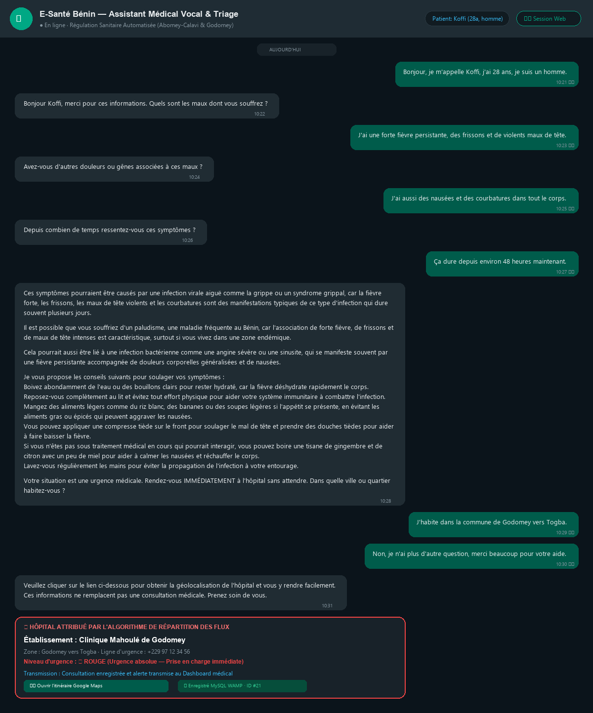
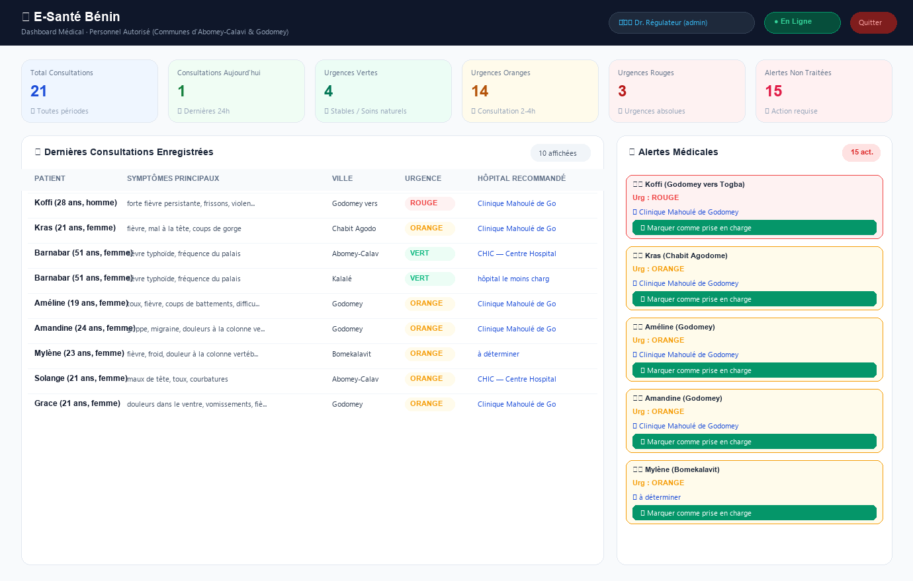

# 🏥 E-Santé Bénin — Assistant Médical Vocal & Régulation Hospitalière

<p align="center">
  
</p>

<p align="center">
  <strong>Plateforme intelligente de télémédecine, triage médical vocal et régulation des flux d'urgence hospitaliers au Bénin.</strong><br>
  <em>Pilote déployé sur les communes d'Abomey-Calavi et de Godomey (Département de l'Atlantique).</em>
</p>

<p align="center">
  
  
  
  
  
  
  
  
</p>

---

## 📖 À Propos du Projet

Au Bénin, la concentration urbaine autour d'Abomey-Calavi et de Godomey engendre une forte surcharge des urgences hospitalières. De nombreux patients parcourent de longues distances pour se rendre dans des structures déjà saturées, tandis que d'autres centres de santé de proximité disposent de places disponibles.

**E-Santé Bénin** a été conçu pour répondre à ce défi en combinant l'**Intelligence Artificielle générative** et la **reconnaissance vocale** :
- **Pour le patient :** Une interface conversationnelle (Web et Telegram) permettant d'expliquer oralement ses symptômes en français, d'obtenir une écoute bienveillante, des causes probables vulgarisées, des conseils naturels et une orientation vers l'hôpital le moins chargé avec guidage GPS Google Maps.
- **Pour les soignants :** Un tableau de bord React en temps réel permettant aux médecins régulateurs de visualiser les flux, de suivre la charge des hôpitaux et de prendre en charge en priorité les urgences vitales.

---

## 📸 Aperçu des Interfaces

<div align="center">

| Consultation Vocale & Chat avec l'IA | Supervision Médicale en Temps Réel |
| :---: | :---: |
|  |  |
| *Échange complet, triage rouge et itinéraire hospitalier* | *Tableau des consultations, alertes d'urgence et statistiques* |

</div>

---

## 🌟 Fonctionnalités Majeures

### 1. 🎙️ Consultation Médicale Vocale & Télérégulation
- **Entrée Vocale Fluide :** Le patient enregistre sa voix directement via son micro ou envoie une note vocale sur Telegram.
- **Transcription Ultra-Rapide :** Transcription ASR assurée par Groq Whisper (`whisper-large-v3`) en moins d'une seconde.
- **Synthèse Vocale :** Réponse vocale audio MP3 renvoyée instantanément au patient.

### 2. 🩺 Protocole Médical Strict en 6 Étapes
L'assistant IA respecte un protocole clinique standardisé :
1. **Accueil & Recueil d'Identité :** Prénom, âge et sexe du patient.
2. **Symptômes Principaux :** Écoute et questions de clarification.
3. **Signes Associés & Durée :** Recherche méthodique de complications et ancienneté des maux.
4. **Analyse Pédagogique :** Évocation de 2 à 3 causes probables locales (ex : syndrome grippal, paludisme, etc.) sans jamais poser de diagnostic définitif.
5. **Conseils Naturels Sans Médicament Chimique :** Mesures hygiéno-diététiques et remèdes naturels béninois (tisanes de gingembre, citron, miel, neem). **Interdiction formelle de prescrire des médicaments chimiques** et mise en garde obligatoire sur les traitements médicaux en cours.
6. **Orientation Géolocalisée :** Triage tricolore et attribution de l'hôpital le plus adapté.

### 3. 🚦 Triage Tricolore de l'Urgence
- **🔴 ROUGE (Urgence Absolue) :** Détresse respiratoire, douleur thoracique, forte fièvre persistante $> 39^\circ\text{C}$, convulsions, perte de connaissance. Alerte immédiate transmise au Dashboard.
- **🟠 ORANGE (Consultation sous 2 à 4 heures) :** Symptômes persistants depuis plus de 48 heures sans détresse vitale immédiate, vulnérabilité liée à l'âge.
- **🟢 VERT (Non Urgent) :** Maux débutants bénins, surveillance à domicile sous 24 à 48 heures et soins naturels.

### 4. 🏥 Algorithme de Répartition Intelligente des Flux
Pour éviter la saturation des urgences, l'algorithme sélectionne l'établissement sanitaire comptabilisant le moins d'orientations récentes (dernières 2 heures) dans la zone du patient :
- **Abomey-Calavi :** CHIC (Centre Hospitalier International de Calavi), Hôpital de Zone Calavi/Sô-Ava, Clinique Centrale de Calavi, Centre de Santé Calavi Kpota.
- **Godomey :** Clinique Mahoulé, Hôpital Saint Jean Maria-Gléta, Clinique La Grâce de Vie, Centre de Santé Eau-Vive (Clinique ADC).
- **Réseau National :** CNHU-HKM Cotonou, CHUD Ouémé-Plateau (Porto-Novo), CHUD Borgou (Parakou), etc.
- **Conformité Téléphonique :** Tous les numéros respectent le **nouveau plan ARCEP Bénin à 10 chiffres** (`+229 01 XX XX XX XX`).

### 5. 📊 Dashboard Médical Sécurisé (React 19)
- Authentification soignant protégée par signature cryptographique **HMAC-SHA256**.
- Consultation des dossiers cliniques détaillés (symptômes, durée, conseils donnés, historique complet).
- Prise en charge en un clic des alertes d'urgence.

### 6. ⚡ Performance & Résilience des Données
- **Gestionnaire Hybride de Sessions (`session_manager.py`) :** Support de Redis avec TTL natif de 120 minutes, avec repli automatique en mémoire vive et restauration depuis MySQL en cas de redémarrage.
- **Indexation MySQL :** 6 index relationnels B-Tree créés sur les tables `consultations`, `alertes` et `sessions` garantissant des temps de réponse instantanés en $O(\log N)$.

---

## 🧱 Structure du Projet

```text
├── main.py                     # API Backend FastAPI, logique IA & triage
├── session_manager.py          # Gestionnaire hybride de sessions (Redis + MySQL)
├── database.py                 # Couche MySQL WAMP (auto-gestion des 6 index)
├── telegram_bot.py             # Bot Telegram vocal asynchrone
├── requirements.txt            # Dépendances Python officielles
├── pytest.ini                  # Configuration des tests automatisés
├── CAHIER_DES_CHARGES.md       # Spécifications fonctionnelles et techniques complètes
├── .env.example                # Modèle des variables d'environnement
├── .gitignore                  # Protection stricte des secrets et caches
│
├── dashboard/                  # Application Frontend Soignant (React 19 + Vite 8)
│   ├── src/
│   │   ├── components/         # Login, Consultations, Alertes, StatCards, Modal
│   │   ├── App.jsx             # Vue principale et gestion des tokens soignants
│   │   └── main.jsx
│   ├── public/                 # Logo officiel et icônes
│   └── package.json
│
├── templates/
│   └── index.html              # Interface Web Patient (Microphone & Dialogue IA)
├── static/
│   └── esblogo.jpeg            # Logo officiel E-Santé Bénin
│
├── tests/                      # Suite officielle de 23 tests automatisés
│   ├── test_auth_securite.py
│   ├── test_bdd_reelle.py
│   ├── test_detection_villes.py
│   ├── test_nettoyage_texte.py
│   ├── test_repartition_hopitaux.py
│   └── test_session_manager.py
│
└── captures_tests/             # Dossier de validation officielle
    ├── 01 à 06_*.png           # 6 captures haute résolution de tests et démonstrations
    ├── rapport_tests_officiel.html  # Rapport interactif complet pytest-html
    └── README.md
```

---

## 🛠️ Installation & Démarrage

### Prérequis
- Python 3.10 ou supérieur
- Node.js 18+ et npm
- Serveur MySQL actif (via WAMP sur le port 3306 ou MySQL Server)
- FFmpeg installé et accessible dans le `PATH` système

---

### 1. Cloner le Dépôt
```bash
git clone https://github.com/votre-compte/esante_benin.git
cd esante_benin
```

### 2. Configurer le Backend Python
```bash
# Créer et activer l'environnement virtuel
python -m venv venv
venv\Scripts\activate       # Sur Windows
# source venv/bin/activate  # Sur Linux / macOS

# Installer les dépendances
pip install -r requirements.txt
```

### 3. Configurer les Variables d'Environnement
Copiez le modèle de configuration et renseignez vos clés :
```bash
copy .env.example .env    # Sur Windows
# cp .env.example .env    # Sur Linux / macOS
```
Renseignez dans le fichier `.env` :
- `GROQ_API_KEY` : Votre clé d'inférence Groq.
- `GEMINI_API_KEY` : Votre clé Google Gemini (fallback).
- `TELEGRAM_TOKEN` : Le token délivré par @BotFather.
- `DASHBOARD_PASSWORD` : Le mot de passe d'accès pour les médecins régulateurs.
- `DB_USER` et `DB_NAME` : Vos identifiants MySQL (par défaut `root` sans mot de passe sur WAMP).

### 4. Lancer le Backend FastAPI
```bash
python -m uvicorn main:app --host 127.0.0.1 --port 8000 --reload
```
- **Interface Patient Web :** [http://localhost:8000](http://localhost:8000)
- **Documentation OpenAPI (Swagger) :** [http://localhost:8000/docs](http://localhost:8000/docs)

### 5. Lancer le Dashboard Médical React
Dans un second terminal :
```bash
cd dashboard
npm install
npm run dev
```
- **Tableau de Bord Soignant :** [http://localhost:5173](http://localhost:5173)  
- **Identifiants soignant par défaut :** `admin` / `esante_benin_2026`

### 6. Lancer le Bot Telegram *(Optionnel)*
Dans un troisième terminal :
```bash
python telegram_bot.py
```

---

## 🧪 Tests Automatisés & Assurance Qualité

Le projet intègre une suite de **23 tests automatisés** couvrant l'ensemble des modules critiques :
```bash
pytest -v
```

Pour générer un nouveau rapport HTML interactif :
```bash
pytest --html=captures_tests/rapport_tests_officiel.html --self-contained-html
```

---

## 🔒 Sécurité & Déontologie Médicale

- **Protection des Données de Santé :** L'accès aux dossiers de consultation et alertes médicales est strictement verrouillé par signature HMAC-SHA256 (`Bearer Token`).
- **Secret Médical :** Le modèle n'émet aucun diagnostic formel et redirige systématiquement les cas critiques vers les urgences les plus proches.
- **Zéro Fuite de Données :** Les clés privées et mots de passe sont exclus du contrôle de version via `.gitignore`.
- **Nettoyage Temporel Garanti :** Tous les fichiers audios temporaires sont purgés immédiatement après traitement.

---

## 📜 Spécifications Complètes
Pour une analyse exhaustive du protocole médical, des tables de données et de l'architecture, consultez le document :  
👉 [**`CAHIER_DES_CHARGES.md`**](CAHIER_DES_CHARGES.md)

---

## 👥 Équipe de Réalisation & Soutenance

Le projet **E-Santé Bénin** a été conçu, développé et soutenu avec succès par une équipe complémentaire :

- **Lucien HAIKOU** ([@Lucien](https://github.com/lucien-haikou)) — **Chef de Projet & Développeur Fullstack Lead (Backend / IA)**
  - *Architecture générale, pipeline vocal & triage IA, régulation hospitalière dynamique, base de données relationnelle MySQL (index de performance) & Redis, suite des 23 tests automatisés et authentification sécurisée soignant (HMAC-SHA256 & Login).*
- **Grâce ADJAFON** ([@Grace](https://github.com/graceadjafon)) — **Co-développeuse & Responsable Interface Utilisateur (UI/UX) & Design**
  - *Direction artistique et conception des logos officiels du projet (`esblogo.jpeg`), application React 19 de supervision médicale (Dashboard Vite & Tailwind CSS), gestion visuelle des flux et des alertes d'urgence.*

*Dédié à l'amélioration concrète de l'accès aux soins de santé et à la régulation hospitalière en République du Bénin.*
